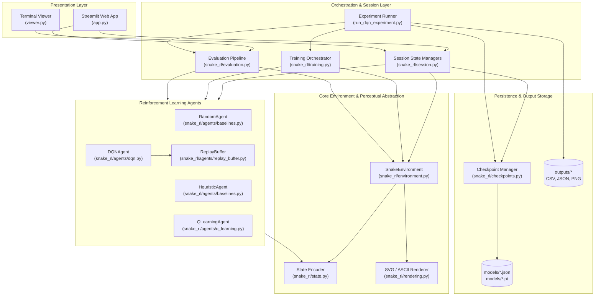
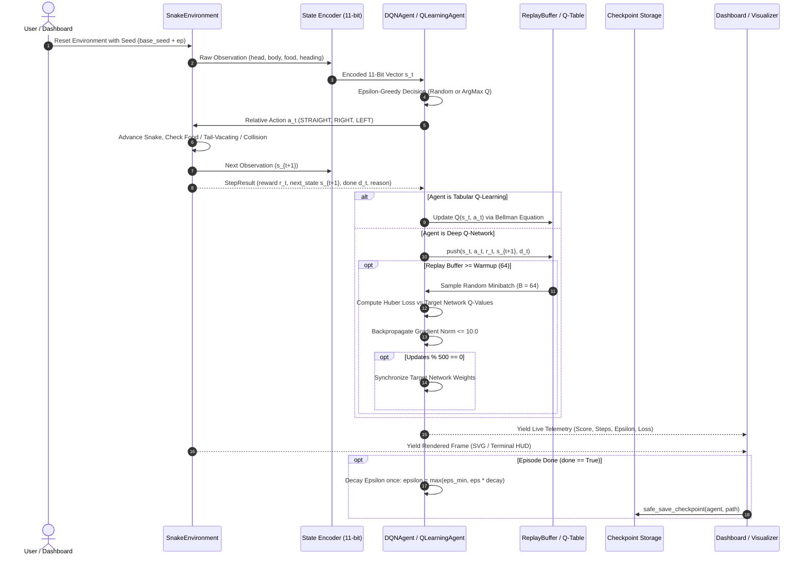
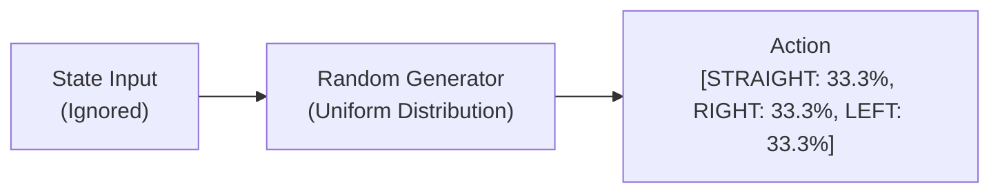
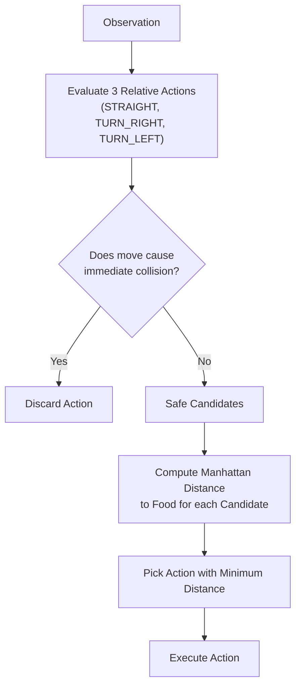
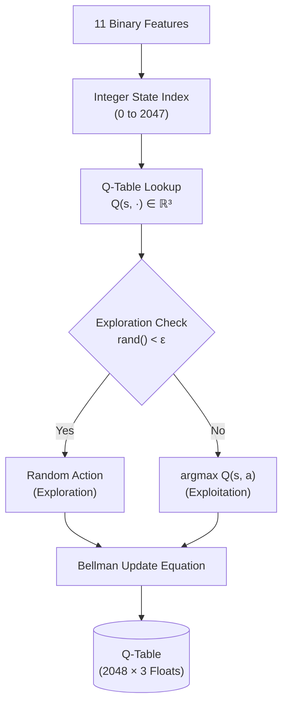
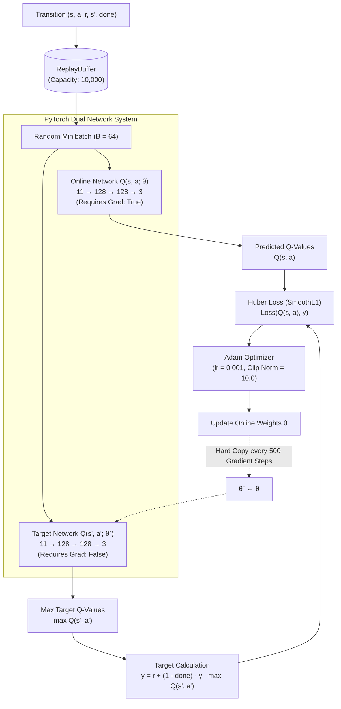

# Snake AI: From Tabular Q-Learning to Deep Q-Networks (DQN)

A complete, decoupled Reinforcement Learning system in pure Python and PyTorch exploring decision-making in the classic game of Snake. This repository implements reinforcement learning algorithms from first principles—spanning from naive random and greedy heuristic baselines, to Tabular Q-Learning with exact Bellman updates, to Deep Q-Networks (DQN) with experience replay and target network stabilization—accompanied by an interactive Streamlit web application, animated terminal visualizer, safe model serialization, and reproducible benchmarking.

---

## Table of Contents
1. [Problem Statement & Motivation](#1-problem-statement--motivation)
2. [Key Features](#2-key-features)
3. [Technology Stack](#3-technology-stack)
4. [System Architecture](#4-system-architecture)
5. [End-to-End Data Flow](#5-end-to-end-data-flow)
6. [Agent Architectures](#6-agent-architectures)
   - [Random Agent](#random-baseline-agent)
   - [Heuristic Agent](#heuristic-rule-based-agent)
   - [Tabular Q-Learning Agent](#tabular-q-learning-agent)
   - [Deep Q-Network (DQN) Agent](#deep-q-network-dqn-agent)
7. [Environment & State Representation](#7-environment--state-representation)
   - [Grid Mechanics & Relative Actions](#grid-mechanics--relative-actions)
   - [11-Bit Perceptual Feature Encoding](#11-bit-perceptual-feature-encoding)
   - [Reward Signal Formulation](#reward-signal-formulation)
8. [Algorithm Hyperparameters](#8-algorithm-hyperparameters)
9. [Training vs. Evaluation Modes](#9-training-vs-evaluation-modes)
10. [Model Checkpointing & Serialization](#10-model-checkpointing--serialization)
11. [Empirical Results & Benchmark Comparison](#11-empirical-results--benchmark-comparison)
12. [Evaluation Methodology & Limitations](#12-evaluation-methodology--limitations)
13. [Quickstart & Usage Guide](#13-quickstart--usage-guide)
14. [Testing & Verification](#14-testing--verification)

---

## 1. Problem Statement & Motivation

The game of Snake represents a constrained Markov Decision Process (MDP) with sparse positive feedback and catastrophic failure states. While human players intuitively plan multi-step paths around obstacles and self-trapping loops, an autonomous agent must discover:
1. **Goal-directed spatial navigation:** Pursuing non-stationary food items.
2. **Boundary and obstacle avoidance:** Avoiding walls and self-collision.
3. **Long-horizon path sustainability:** Preventing self-entrapment as the snake's body elongates.

A raw $20 \times 20$ grid yields $400$ cell positions and an astronomical number of possible body configurations ($4^L$ where $L$ is snake length). This project investigates how a **compact perceptual feature abstraction (11 binary bits)** can compress this vast state space into $2^{11} = 2,048$ tractable states, enabling direct comparative analysis between:
- Classical **Tabular Q-Learning** (exact tabular Bellman updates).
- **Deep Q-Networks (DQN)** (continuous neural function approximation with experience replay).
- Baseline policies (**Random exploration** and **Greedy rule-based heuristics**).

---

## 2. Key Features

- **Headless Game Engine (`snake_rl/environment.py`):** Pure Python environment decoupled from display servers, rendering pipelines, or external GUI event loops.
- **Perceptual 11-Bit State Encoding (`snake_rl/state.py`):** Encodes immediate danger in 3 headings, current heading (one-hot), and food quadrants, mapping exactly to $2,048$ discrete states.
- **Relative Movement Action Space:** Restricts choices to `STRAIGHT`, `TURN_RIGHT`, and `TURN_LEFT` relative to the snake's heading, preventing instant 180° reversals by construction.
- **Tabular Q-Learning (`snake_rl/agents/q_learning.py`):** $2,048 \times 3$ Q-table updated via the Bellman equation with non-bootstrapped terminal transitions and per-episode $\epsilon$-decay.
- **Deep Q-Networks (`snake_rl/agents/dqn.py`):** Multi-Layer Perceptron ($11 \rightarrow 128 \rightarrow 128 \rightarrow 3$) utilizing experience replay ($N=10,000$), Adam optimization ($\text{lr}=0.001$), Huber loss (`SmoothL1Loss`), and frozen target network synchronization every 500 gradient updates.
- **Interactive Streamlit Web Dashboard (`app.py`):** Features 5 dedicated tabs:
  1. `🎮 Play`: Live visual evaluation of trained checkpoints under pure exploitation.
  2. `🧠 Train`: Observable real-time training with dynamic SVG graphics and DQN optimization telemetry.
  3. `📊 Compare`: Multi-agent benchmark comparisons across identical fixed seeds.
  4. `📈 Results & Analysis`: Interactive charts and static multi-panel plots from offline experiment runs.
  5. `📖 How It Works`: Educational deep dive into algorithms and state math.
- **Terminal Viewer (`viewer.py`):** Animated ANSI terminal visualizer with Heads-Up Display (HUD).
- **Controlled Experiment Runner (`run_dqn_experiment.py`):** Automated script for training, metric recording (JSON & CSV), publication-quality plot generation, and benchmark evaluation.
- **Safe Checkpoint Management (`snake_rl/checkpoints.py`):** JSON serialization for tabular policies and PyTorch `.pt` serialization for DQN, with overwrite protection.
- **100% Test Coverage:** 77 passing unit tests verifying mathematical arithmetic, state invariants, neural network shapes, replay buffer sampling, and UI sessions.

---

## 3. Technology Stack

- **Core Language:** Python 3.13
- **Deep Learning Framework:** PyTorch 2.12.0 (CPU execution, `nn.SmoothL1Loss`, `torch.optim.Adam`)
- **Web Application:** Streamlit 1.55.0 (Reactive web UI with custom dark CSS and hardware-accelerated SVG)
- **Data Analysis & Visualization:** 
  - Pandas 2.2.2 & NumPy 2.3.4 (Dataframe processing and moving averages)
  - Matplotlib 3.10.7 (Publication-quality 6-panel training curves)
- **Standard Library Modules:** `unittest`, `dataclasses`, `argparse`, `json`, `csv`, `collections.deque`, `random`, `math`, `pathlib`

---

## 4. System Architecture

The project adheres to a strict layered architecture where visualization, orchestration, core reinforcement learning algorithms, and the underlying simulation engine are completely decoupled:



---

## 5. End-to-End Data Flow

The following sequence details how state transitions, action selection, learning updates, checkpointing, and live visualization interact during an active training step:



---

## 6. Agent Architectures

### Random Baseline Agent
Selects actions uniformly at random from the 3 relative movement choices. It establishes the empirical lower performance bound ($0.05 - 0.10$ mean score).



### Heuristic Rule-Based Agent
An analytical greedy policy that acts as a strong classical benchmark without learning. It operates via a two-tier priority decision process:
1. **Safety Filter:** Evaluates the 3 possible moves and eliminates any action that immediately causes a wall or body collision.
2. **Greedy Food Pursuit:** For all non-colliding moves, computes the resulting Manhattan distance to the food:
   $$D_{\text{Manhattan}} = |x_{\text{head}} - x_{\text{food}}| + |y_{\text{head}} - y_{\text{food}}|$$
   Selects the action that minimizes distance to the food. If multiple actions tie, deterministic tie-breaking is applied.



### Tabular Q-Learning Agent
Maintains a discrete lookup table $Q(s, a)$ of shape $(2048, 3)$. The 11 binary state features are converted to an integer state index $s \in [0, 2047]$ using bitwise base-2 summation:
$$s = \sum_{i=0}^{10} b_i \cdot 2^i$$



#### The Tabular Bellman Update Rule:
For non-terminal steps ($done = \text{False}$):
$$Q(s_t, a_t) \leftarrow Q(s_t, a_t) + \alpha \left[ r_t + \gamma \max_{a'} Q(s_{t+1}, a') - Q(s_t, a_t) \right]$$

For terminal steps ($done = \text{True}$):
$$Q(s_t, a_t) \leftarrow Q(s_t, a_t) + \alpha \left[ r_t - Q(s_t, a_t) \right]$$
> **Terminal Target Rule:** When the snake dies, no future states exist. The target simplifies strictly to $r_t$, eliminating invalid bootstrapping.

---

### Deep Q-Network (DQN) Agent
Replaces the discrete lookup table with a neural network function approximator $Q(s, a; \theta)$. The architecture consists of a PyTorch Multi-Layer Perceptron (MLP) with two fully connected hidden layers:
$$11 \xrightarrow{\text{Linear}} 128 \xrightarrow{\text{ReLU}} 128 \xrightarrow{\text{Linear}} 128 \xrightarrow{\text{ReLU}} 128 \xrightarrow{\text{Linear}} 3$$



#### Core Components for DQN Stability:
1. **Experience Replay (`ReplayBuffer`):** Fixed-capacity circular FIFO buffer holding $10,000$ transitions. Minibatch sampling ($B=64$) decorrelates sequential environment frames.
2. **Target Network Freezing:** Prevents the moving-target instability of non-stationary bootstrapping. Synchronized via parameter state-dict copy every 500 gradient updates.
3. **Huber Loss (`nn.SmoothL1Loss`):** Smooth transition between quadratic loss (for small errors) and linear loss (for large errors), preventing gradient explosions:
   $$L_\delta(y, Q) = \begin{cases} 
   \frac{1}{2}(y - Q)^2 & \text{for } |y - Q| \le 1 \\
   |y - Q| - \frac{1}{2} & \text{otherwise}
   \end{cases}$$
4. **Gradient Norm Clipping:** All parameter gradients are clipped at $\text{max\_norm} = 10.0$ before optimizer execution.

---

## 7. Environment & State Representation

### Grid Mechanics & Relative Actions
- **Grid Dimensions:** Discrete $20 \times 20$ grid (indices $0 \le x < 20$, $0 \le y < 20$).
- **Head & Tail Tracking:** The snake advances one cell per step. When moving without eating, the tail coordinate vacates on that exact step. Moving into the current tail cell is legal if the tail vacates.
- **Relative Actions:** Actions are defined relative to the current heading:
  - `0: STRAIGHT`: Continue in current direction.
  - `1: TURN_RIGHT`: Turn 90° clockwise.
  - `2: TURN_LEFT`: Turn 90° counter-clockwise.

```text
Heading: UP      Heading: RIGHT     Heading: DOWN     Heading: LEFT
  STRAIGHT -> UP    STRAIGHT -> RIGHT  STRAIGHT -> DOWN  STRAIGHT -> LEFT
  RIGHT    -> RIGHT RIGHT    -> DOWN   RIGHT    -> LEFT  RIGHT    -> UP
  LEFT     -> LEFT  LEFT     -> UP     LEFT     -> RIGHT LEFT     -> DOWN
```

### 11-Bit Perceptual Feature Encoding

| Index | Feature Name | Description | Values |
| :---: | :--- | :--- | :---: |
| **0** | Danger Straight | Wall or body 1 cell straight ahead | `0` or `1` |
| **1** | Danger Right | Wall or body 1 cell 90° to the right | `0` or `1` |
| **2** | Danger Left | Wall or body 1 cell 90° to the left | `0` or `1` |
| **3** | Heading Left | Snake is moving LEFT | `0` or `1` |
| **4** | Heading Right | Snake is moving RIGHT | `0` or `1` |
| **5** | Heading Up | Snake is moving UP | `0` or `1` |
| **6** | Heading Down | Snake is moving DOWN | `0` or `1` |
| **7** | Food Left | Food coordinate $x_{\text{food}} < x_{\text{head}}$ | `0` or `1` |
| **8** | Food Right | Food coordinate $x_{\text{food}} > x_{\text{head}}$ | `0` or `1` |
| **9** | Food Up | Food coordinate $y_{\text{food}} < y_{\text{head}}$ | `0` or `1` |
| **10** | Food Down | Food coordinate $y_{\text{food}} > y_{\text{head}}$ | `0` or `1` |

> **Axis Alignment Behavior:** When the food is directly aligned with the snake's head along an axis (e.g. $x_{\text{head}} == x_{\text{food}}$), both directional flags for that axis evaluate to `0`.

### Reward Signal Formulation

| Event | Scalar Reward | Rationale |
| :--- | :---: | :--- |
| **Food Consumed** | `+10.0` | Primary objective; extends snake length by 1 cell. |
| **Collision (Wall or Self)** | `-10.0` | Strong terminal penalty; terminates episode immediately. |
| **Normal Move** | `-0.1` | Small step penalty; incentivizes shortest paths and discourages looping. |
| **Step Limit (1,000 steps)** | `0.0` | Bounded safety cutoff to prevent infinite non-terminating loops. |

---

## 8. Algorithm Hyperparameters

The following table reflects the actual project configuration used in our experiments:

| Parameter | Tabular Q-Learning | Deep Q-Network (DQN) |
| :--- | :---: | :---: |
| **Model Representation** | Discrete Table $(2048 \times 3)$ | PyTorch MLP $(11 \rightarrow 128 \rightarrow 128 \rightarrow 3)$ |
| **Input / State Dimension** | Integer index $\in [0, 2047]$ | Float tensor of shape $(B, 11)$ |
| **Output / Action Dimension** | 3 actions | 3 action Q-values |
| **Learning Rate ($\alpha$ / $\text{lr}$)** | $0.10$ | $0.001$ (Adam Optimizer) |
| **Discount Factor ($\gamma$)** | $0.90$ | $0.90$ |
| **Loss Function** | Temporal Difference Error | Huber Loss (`SmoothL1Loss`, $\beta=1.0$) |
| **Gradient Clipping** | N/A | $\text{max\_norm} = 10.0$ |
| **Exploration ($\epsilon_{\text{start}}$)** | $1.0$ | $1.0$ |
| **Exploration Floor ($\epsilon_{\min}$)** | $0.01$ | $0.01$ |
| **Exploration Decay Rate** | $0.995$ per episode | $0.995$ per episode |
| **Experience Replay Capacity** | N/A | $10,000$ transitions (FIFO) |
| **Minibatch Size ($B$)** | N/A | $64$ transitions |
| **Warmup Transitions** | N/A | $64$ transitions |
| **Target Sync Interval** | N/A | $500$ gradient update steps |
| **Compute Device** | CPU | CPU (`torch.device('cpu')`) |

---

## 9. Training vs. Evaluation Modes

| Attribute | Training Mode | Evaluation Mode |
| :--- | :--- | :--- |
| **Exploration ($\epsilon$)** | Active ($\epsilon > 0$, decays once per episode) | Frozen ($\epsilon = 0.0$, pure exploitation) |
| **Action Selection** | `select_action_with_mode()` ($\epsilon$-greedy) | `select_greedy_action()` ($\text{argmax}_a Q(s, a)$) |
| **Q-Table / Weights** | Updated continuously via Bellman equations | Completely frozen (zero gradient or value updates) |
| **Replay Memory** | Transitions pushed and minibatches sampled | Completely untouched |
| **Deterministic Seeds** | Varied across training episodes | Fixed benchmark evaluation seeds |
| **Operational Purpose** | Trial-and-error discovery and optimization | Unbiased performance measurement |

---

## 10. Model Checkpointing & Serialization

### Checkpoint Specifications
All checkpoints are saved with metadata and overwrite protection under the `models/` directory:
- **`models/q_table_500ep.json` (95.3 KB):** Trained Tabular Q-learning model (500 episodes). Contains full $2048 \times 3$ matrix, configuration, final epsilon ($0.0816$), and episode metrics.
- **`models/dqn_200ep_seed42.pt` (298.5 KB):** Trained Deep Q-Network model (200 episodes). Contains online state dict, target state dict, optimizer state dict, configuration, train step count ($13,004$), final epsilon ($0.3670$), and metadata.

### How to Load and Evaluate Models in Python

#### Tabular Q-Learning:
```python
from snake_rl.checkpoints import load_q_table
from snake_rl.environment import SnakeEnvironment
from snake_rl.evaluation import evaluate_agent

env = SnakeEnvironment()
agent = load_q_table("models/q_table_500ep.json")
result = evaluate_agent(env, agent, num_episodes=20, base_seed=1000)
print(f"Q-Learning Mean Score: {result.mean_score:.2f} ± {result.std_score:.2f}")
```

#### Deep Q-Network (DQN):
```python
from snake_rl.checkpoints import load_dqn_checkpoint
from snake_rl.environment import SnakeEnvironment
from snake_rl.evaluation import evaluate_agent

env = SnakeEnvironment()
agent = load_dqn_checkpoint("models/dqn_200ep_seed42.pt", device="cpu")
result = evaluate_agent(env, agent, num_episodes=20, base_seed=1000)
print(f"DQN Mean Score: {result.mean_score:.2f} ± {result.std_score:.2f}")
```

---

## 11. Empirical Results & Benchmark Comparison

### Multi-Agent Benchmark on Identical Evaluation Seeds
To ensure scientific fairness, all agents were evaluated across the **exact same 20 deterministic seeds** (`seeds 1001–1020`, with `base_seed = 1000`) under **pure exploitation** ($\epsilon = 0.0$):

| Agent Policy | Model Source | Mean Score | Std Dev | Max Score | Min Score | Mean Steps | Mean Reward | Primary Cause of Failure |
| :--- | :--- | :---: | :---: | :---: | :---: | :---: | :---: | :--- |
| **DQN (Trained 200ep)** | `models/dqn_200ep_seed42.pt` | **37.55** | ±11.07 | **53** | 14 | **646.5** | **+305.20** | Self-collision (17/20), Wall (2/20) |
| **Heuristic Baseline** | Rule-Based Analytic Policy | **31.30** | ±11.36 | **51** | 10 | 460.1 | +260.21 | Self-collision (19/20), Wall (1/20) |
| **Q-Learning (500ep)** | `models/q_table_500ep.json` | **21.30** | ±8.30 | **35** | 7 | 304.3 | +174.80 | Self-collision (19/20), Wall (1/20) |
| **Random Baseline** | Uniform Random Policy | **0.10** | ±0.31 | 1 | 0 | 72.5 | -16.14 | Wall collision (20/20) |
| **DQN (Untrained)** | Random Initialized MLP | **0.00** | ±0.00 | 0 | 0 | 950.7 | -95.56 | Step limit (19/20), Wall (1/20) |

```text
Mean Score Comparison across 20 Fixed Evaluation Seeds:
DQN (200 ep)      █████████████████████████████████████▌ 37.55
Heuristic Agent   █████████████████████████████▎ 31.30
Q-Learning (500ep)███████████████████ 21.30
Random Baseline   ▏ 0.10
Untrained DQN     0.00
```

### 200-Episode DQN Controlled Training Progression
Recorded during the training of `models/dqn_200ep_seed42.pt` across 200 episodes ($13,067$ total environment steps, $13,004$ gradient updates, $5.69$s total duration on CPU):

```text
Training Convergence Milestones:
- Ep 1–50   (ε: 1.00 -> 0.78): High exploration. Snake frequently crashes into walls; mean loss ~0.01.
- Ep 51–100 (ε: 0.78 -> 0.61): Food navigation emerges. Step throughput increases; loss rises to ~0.06.
- Ep 101–150 (ε: 0.61 -> 0.47): Exploitation begins dominating. Scores climb to 5-10; loss peaks at ~0.11.
- Ep 151–200 (ε: 0.47 -> 0.37): Consistent food harvesting. Long survival runs; mean score in last 20 reaches 2.25 (with active exploration).
```

### Experiment Artifacts
The training run generated complete reproducible metrics under `outputs/dqn_200ep_seed42/`:
- `metrics.json` & `metrics.csv`: Per-episode record of scores, rewards, steps, loss, epsilon, cumulative steps, and updates.
- `evaluation_summary.json`: Detailed evaluation distribution on seeds 1001–1020.
- `training_curves.png`: High-resolution 6-panel visualization tracking score, reward, loss, epsilon decay, throughput, and duration.

---

## 12. Evaluation Methodology & Limitations

### Scientific Methodology
1. **Identical Seed Reuse:** Every evaluated agent is tested on the exact same pseudo-random food coordinates and snake spawn positions (`base_seed = 1000` + episode index).
2. **Seed Independence:** The evaluation seeds (`1001–1020`) are completely disjoint from the training seeds (`43–242`), verifying true out-of-sample generalization.
3. **Exploration Isolation:** All stochastic exploration is disabled ($\epsilon = 0.0$); actions are chosen strictly by policy argmax.

### Known Limitations
1. **Perceptual Horizon (Local 11-Bit State):** The 11-bit representation senses danger only 1 cell ahead. It does not perceive whether moving into an open pocket will lead to a dead-end trap 5 cells later. Consequently, for snakes of length $> 35$, self-collisions become the primary death cause.
2. **Tabular State Space Sparsity:** While 2,048 states is compact, several rare combinations (e.g., danger straight and right while moving UP with food DOWN-LEFT) are infrequently visited during 500 episodes of tabular training. DQN addresses this via generalization across continuous feature embeddings.

---

## 13. Quickstart & Usage Guide

### 1. Launch the Streamlit Web Application
Start the interactive dashboard in your browser:
```bash
.venv/bin/python -m streamlit run app.py
```
Open `http://localhost:8501` to access:
- **`🎮 Play`**: Watch `models/dqn_200ep_seed42.pt` or `models/q_table_500ep.json` play in real time.
- **`🧠 Train`**: Watch Tabular Q-learning or DQN learn live with real-time SVG board rendering and HUD telemetry.
- **`📊 Compare`**: Run live multi-agent evaluations across customized seed counts.
- **`📈 Results & Analysis`**: Browse interactive charts, metrics, and multi-panel curves from offline runs.

### 2. Run the Controlled DQN Experiment Script
To reproduce the 200-episode DQN experiment headlessly:
```bash
.venv/bin/python run_dqn_experiment.py --episodes 200 --seed 42 --gamma 0.90 --device cpu
```

### 3. Launch the Terminal Visualizer (CLI Alternative)
Watch animated gameplay in your terminal:
```bash
# Play trained DQN checkpoint
.venv/bin/python viewer.py --mode eval --checkpoint models/dqn_200ep_seed42.pt --episodes 5

# Play trained Q-table checkpoint
.venv/bin/python viewer.py --mode eval --checkpoint models/q_table_500ep.json --episodes 5

# Watch live terminal training (10 episodes)
.venv/bin/python viewer.py --mode train --agent dqn --episodes 10
```

---

## 14. Testing & Verification

The repository contains a test suite of **77 automated unit tests** built with Python's standard `unittest` framework:

```bash
.venv/bin/python -m unittest discover -s tests -p "test_*.py" -v
```

### Test Suite Breakdown:
1. `tests/test_environment.py`: Grid bounds, snake body mechanics, food placement, relative action transitions, step limit, and tail-vacating mechanics.
2. `tests/test_state.py`: 11-bit feature encoding, one-hot direction checks, wall/body danger detection, food quadrant mapping, integer state bijection ($0 \dots 2047$).
3. `tests/test_q_learning.py`: Bellman update arithmetic, non-bootstrapped terminal updates, per-episode epsilon decay, and Q-table serialization.
4. `tests/test_dqn.py`: MLP architecture shapes, experience replay push/sample tensors, Huber loss optimization, target network synchronization, checkpoint save/load roundtrips.
5. `tests/test_training_and_evaluation.py`: Bounded training loops, deterministic seed repeatability, pure greedy evaluation neutrality, baseline agents, fair seed comparisons.
6. `tests/test_rendering_and_viewer.py`: SVG generation, ASCII board formatting, HUD layout, interactive runner pauses/stops.
7. `tests/test_session.py`: Multi-tab Streamlit session manager, stepping/pausing guarantees, safe checkpoint overwrite prevention, and DQN sync telemetry math.

**Test Result:** All 77 tests pass in under 0.8 seconds.
